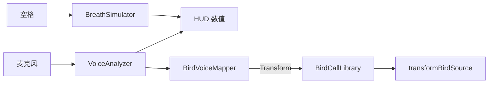

# Avian Voice 场景说明与后续操作指南

本文档说明 `Assets/AvianVoice/Scenes/` 下每个场景的用途、运行时会发生什么、以及你需要在 Unity 里手动完成的后续步骤。

---

## 一、场景总览

| 场景文件 | 场景名（Build） | 主要用途 | 对应研究阶段 |
|----------|-----------------|----------|--------------|
| `Avian_Lab.unity` | Avian_Lab | **主实验室**：语音映射 + 鸟身幻觉 + 呼吸 + HUD，日常调试入口 | 阶段 1 + 2 |
| `Task_PitchMatching.unity` | Task_PitchMatching | **音高匹配训练**：听参考鸟叫并模仿，羽毛发光反馈 | 阶段 3 |
| `Task_FlightControl.unity` | Task_FlightControl | **飞行控制训练**：用音高控制高度，用呼吸稳定飞行 | 阶段 3 |
| `Task_SongPerformance.unity` | Task_SongPerformance | **鸣叫序列表演**：按顺序模仿鸟鸣，累积分数与鸟群视觉 | 阶段 3 |

当前四个场景在磁盘上基于 `BasicScene` 模板（地面 + 平行光 + EventSystem），**场景文件里尚未预先摆放 XR Rig、森林环境或鸟模型**。  
进入 Play 后，由脚本 **`AvianVoiceSceneAutoLoad`** 与 **`AvianLabRuntimeSetup`** 自动创建核心对象（见下文「运行时自动装配」）。

---

## 二、运行时自动装配（所有 Avian / Task 场景共用）

只要场景名以 `Avian` 或 `Task_` 开头，Play 时会自动执行：

1. 创建 `AvianLabRuntimeSetup` 物体  
2. 查找场景中名为 **`XR Origin`** 的物体；若**没有**，则只打日志警告（需你手动放入 Prefab，见第三节）  
3. 若有 XR Origin，则在其上挂载并初始化：
   - 麦克风采集 `MicrophoneCapture`
   - 音高/响度分析 `VoiceAnalyzer`
   - 鸟鸣映射 `BirdVoiceMapper` + `BirdCallLibrary`（无 WAV 时使用程序化短促鸟鸣）
   - 呼吸模拟 `BreathSimulator`
   - 鸟身控制 `BirdBodyController` + 翅膀映射 `WingHandMapper`
   - 喙部粒子 `BeakVocalFX`
   - 身体同步 `BreathBodySync`
   - 镜子 `MirrorBodySetup`（若启用）
   - 实验日志 `SessionRecorder`
4. 在 Camera Offset（或 XR Origin）下生成 **占位鸟身** `AvianBody_Placeholder`（方块组成的胸、头、喙、双翅）
5. 生成世界空间 **HUD**（呼吸条、响度、音高、延迟估算）与 **模式切换**（T 键）

任务场景会额外创建：

- `TaskManager`：任务列表与场景切换  
- `TaskRoot` + 对应任务脚本（见各场景说明）

---

## 三、各场景功能详解

### 1. `Avian_Lab.unity` — 主实验室（建议每天开发从这里进）

**设计目标**  
集成测试「鸟身幻觉 + 实时语音 → 鸟叫反馈 + 呼吸驱动身体」，不依赖具体训练任务逻辑。

**运行时你会看到 / 能做什么**

| 功能 | 说明 |
|------|------|
| 第一人称占位鸟身 | 胸/头/喙/翅膀挂在相机前方，翅膀随 XR 手或桌面模拟扑动 |
| 麦克风分析 | 对着外接麦说话，HUD 显示 **音高 (Hz)**、**响度**、**估算延迟 (ms)** |
| Transform 模式（默认） | 你的声音触发 **程序化鸟鸣**（音高选最近一档 chirp） |
| Assistive 模式 | 按 **T** 切换；调整监听音高（有 AudioMixer 时走 Mixer，否则改 AudioSource.pitch） |
| 呼吸 | **按住 Space** 吸气，松开呼气；胸腔会轻微 Scale，呼气时翅膀微颤 |
| 镜子 | `MirrorBodySetup` 在前方生成 RenderTexture 镜子（需鸟身在 `BirdMirror` 层才理想，见第五节） |
| 数据记录 | 约 30 Hz 写入 `avian_trials.jsonl`（见第七节路径） |

**本场景不包含**  
- ForestVision 森林（需你合并环境）  
- 正式 rigged 鸟模型（当前为占位几何体）  
- 预置在场景里的 XR Origin Hands Prefab（需你添加一次）

**推荐操作顺序（首次）**

1. Unity 菜单：**Avian Voice → Setup Project**（生成 Settings、Layer、把 Lab 写入 Build Settings；若 Lab 已存在会跳过重建）  
2. 打开 `Assets/AvianVoice/Scenes/Avian_Lab.unity`  
3. 从 Project 拖入 Prefab（勿用 `VRTemplateAssets/.../Complete XR Origin Set Up Variant`，该资源缺少嵌套 Prefab）：  
   `Assets/Samples/XR Interaction Toolkit/3.4.1/Hands Interaction Demo/Prefabs/XR Origin Hands (XR Rig).prefab`  
4. 保存场景（Ctrl+S）  
5. Play → 允许麦克风 → 对着麦发声，观察 HUD  

---

### 2. `Task_PitchMatching.unity` — 音高匹配任务

**设计目标**  
系统周期性播放 **参考鸟叫**（默认 440 Hz 附近），用户用嗓音模仿；实时计算音高误差并驱动 **羽毛/胸部发光** 作为正反馈。

**额外运行时组件**

- `TaskRoot` → `PitchMatchingTask`  
- 每约 3 秒播放一次参考叫  
- 用户发声且 `voiced > 0.5` 时更新匹配分数（0–1），并上报 `TaskManager` / `SessionRecorder`

**你怎么试**

1. 同样先确保场景里有 **XR Origin Hands** Prefab  
2. Play 后听参考叫 → 用相近音高哼/唱  
3. 观察占位鸟 **胸部 Renderer** 是否变亮（Emission）  

**建议你后续在 Editor 里做的**

- [ ] 将 `targetPitchHz`（Inspector）改成实验设计的目标音高  
- [ ] 导入真实鸟鸣 WAV 到 `BirdCallLibrary`，替换程序化 chirp  
- [ ] 把场景环境换成 `Assets/ForestVision/Scenes/Sample1.unity` 的内容（复制地形/光照到本场景，或把 Task 场景另存为 Forest 子场景）  
- [ ] 用 rigged 鸟模型的 Renderer 替换 `featherRenderer` 引用（带 Emission 的材质效果更好）  

---

### 3. `Task_FlightControl.unity` — 飞行控制任务

**设计目标**  
用 **音高** 映射垂直方向（越高音越高飞），用 **呼吸深度** 映射飞行稳定性；体现「发声 + 呼吸」联合控制。

**额外运行时组件**

- `TaskRoot` → `FlightControlTask` + `CharacterController`  
- 每帧根据 `pitchHz` 与 `breath.depth` 移动 `TaskRoot`（向前 + 垂直校正）

**你怎么试**

1. 确保 XR Origin 在场景中  
2. Play → 变化音高（哼不同音高）→ 看 `TaskRoot` 高度变化  
3. **Space 按住** 使呼吸接近 0.5，移动更稳；极端吸气/呼气时稳定性下降  

**建议你后续在 Editor 里做的**

- [ ] 把 `FlightControlTask` 挂到 **用户可见的鸟身/飞行器** 上，而不是空的 TaskRoot（或将 TaskRoot 设为 XR Origin 子物体）  
- [ ] 增加天空盒、简化地形或 ForestVision 远景  
- [ ] 调整 `pitchHeightScale`、`breathStability`、`forwardSpeed` 以符合舒适度  
- [ ] Quest 上测试是否会晕：降低 `forwardSpeed`、加舒适 vignette  

---

### 4. `Task_SongPerformance.unity` — 鸣叫序列任务

**设计目标**  
按预设 **旋律音高序列**（默认 330 → 392 → 440 → 494 Hz）依次模仿；每命中一节增加分数，并在周围生成 **鸟群小球**（占位，可换成鸟 Prefab）。

**额外运行时组件**

- `TaskRoot` → `SongPerformanceTask`  
- 命中当前目标音高（容差约 50 Hz）后进入下一音、播放下一参考叫、`SpawnFlockBird`  

**你怎么试**

1. Play → 听第一个目标音 → 模仿 → 得分 +1 且场景多一个小球  
2. 依次完成 4 个音高  

**建议你后续在 Editor 里做的**

- [ ] 在 Inspector 修改 `melodyHz` 数组为你的实验刺激  
- [ ] 指定 `flockBirdPrefab`（低多边形鸟或粒子群）  
- [ ] 加 `TaskFlowUI` Canvas 显示当前音符与总分（需手动摆 UI 并 Bind `TaskManager`）  
- [ ] 森林 clearing 布景 + 空间音频环境声  

---

## 四、任务模式切换（推荐：只玩 Avian_Lab）

**不必**把森林、Parrot 复制到 `Task_*.unity`。日常开发只打开 **`Avian_Lab.unity`**，在同一场景里切换任务：

| 按键 | 模式 |
|------|------|
| `1` | **Avian Lab**（默认：呼吸 + 语音 + 鸟身，无任务计分） |
| `2` | **Pitch Matching**（音高匹配 + 胸部发光） |
| `3` | **Flight Control**（音高控高度、呼吸稳飞行；**移动 XR Origin**） |
| `4` | **Song Performance**（旋律模仿 + 鸟群小球） |
| `N` 或 `]` | 下一个模式（循环） |

- 头显前方 **TaskModeHUD** 显示当前任务名、说明与分数。  
- 右侧指标 HUD 提示：`1-4=Task | Space=Inhale | T=Voice`。  
- 实现：`TaskManager` 的 **InScene** 模式只启用/禁用对应脚本，**不** `LoadScene`。

`Task_PitchMatching` / `Task_FlightControl` / `Task_SongPerformance` 场景仍可在 Build Settings 中保留作备用；若 `TaskManager.switchMode = LoadScene`，则 `AdvanceTask()` 仍会按场景名异步加载（旧流程）。

**Build Settings 场景路径**

- `Assets/AvianVoice/Scenes/Avian_Lab.unity`（主入口）  
- `Assets/AvianVoice/Scenes/Task_PitchMatching.unity`（可选）  
- `Assets/AvianVoice/Scenes/Task_FlightControl.unity`（可选）  
- `Assets/AvianVoice/Scenes/Task_SongPerformance.unity`（可选）  

---

## 五、推荐后续操作清单（按优先级）

### A. 必做（否则 Play 可能只有地面、无 VR）

1. **执行 Setup**  
   - 菜单 **Avian Voice → Setup Project**  
2. **每个 Avian/Task 场景放入 XR Rig**  
   - Prefab：`XR Origin Hands (XR Rig).prefab`（路径见第三节）  
   - 保存场景  
3. **确认麦克风**  
   - Windows：系统默认输入设备为你的动圈麦  
   - Editor Play 时允许 Unity 使用麦克风  

### B. 强烈建议（提升幻觉与实验质量）

4. **导入 rigged 鸟模型**  
   - 翅膀骨骼绑定到 `AvianAppBootstrap` 的 Left/Right Wing  
   - 喙 BlendShape 索引填到 `beakBlendShapeIndex`  
   - 关闭 `AvianLabRuntimeSetup.autoSetup`，改用你自己做的 `AvianBody_FPV` Prefab  
5. **导入鸟鸣 WAV**  
   - 放到 `Assets/AvianVoice/Audio/Calls/`  
   - 拖到 `BirdCallLibrary.clips`，设好每条的 `basePitchHz`  
6. **合并 ForestVision 环境**  
   - 打开 `Assets/ForestVision/Scenes/Sample1.unity`  
   - 复制 Terrain、光照、Post Processing 到 `Avian_Lab` 或各 Task 场景  
7. **创建 Audio Mixer**  
   - `Assets/AvianVoice/Audio/Mixer/AvianVoice.mixer`  
   - 暴露参数 `MicPitch`、`MicReverb`，填到 `AvianAppBootstrap` 的 Mixer Reference  

### C. 实验与 Quest 部署

8. **生成 Settings 资源**（若 Setup 后仍没有 `.asset`）  
   - Project 窗口右键：**Create → Avian Voice → Settings**  
   - 再 **Create → Avian Voice → Platform Profile**  
   - 拖到 `AvianLabRuntimeSetup` 的 `settings` / `platformProfile`  
9. **桌面 XR 模拟**  
   - **Edit → Project Settings → XR Plug-in Management** → PC 勾选 **XR Simulation** 或 OpenXR  
10. **Quest 构建**  
    - 切换 Android，启用 Meta OpenXR  
    - 外接 USB/3.5mm 麦测试  
    - `PlatformProfile` 选 Quest，`questDspBufferSize = 512`  
11. **对照条件开关**（论文用）  
    - `AvianVoiceSettings`：`mirrorEnabled`、`wingMappingEnabled`  
    - 或复制两份 `PlatformProfile` 做 A/B  

---

## 六、键盘与交互速查

| 输入 | 作用 |
|------|------|
| **Space 按住** | 吸气（`BreathSimulator`） |
| **Space 松开** | 呼气 |
| **T** | Assistive ↔ Transform 语音模式 |
| **对着麦克风发声** | 触发分析、鸟鸣、喙部粒子、任务评分 |
| **桌面预览：WASD** | 在场景中平移 XR Rig（前后左右） |
| **桌面预览：Q / E** | 下降 / 上升 |
| **桌面预览：按住右键 + 移动鼠标** | 环顾四周（类似 3D 游戏视角） |
| **桌面预览：Shift** | 加速移动 |

VR 中：双手追踪驱动翅膀；桌面无头显时用 **模拟扑翼**（`PlatformProfile.useSimulatedHands = true`）。  
桌面无头显时还会自动启用 **`DesktopFlyCamera`**（可在 `PlatformProfile` 关闭 `Enable Desktop Fly Camera`）。

---

## 七、数据日志位置

`SessionRecorder` 会追加 JSON Lines：

- **Windows Editor**：通常  
  `C:\Users\<你的用户名>\AppData\LocalLow\DefaultCompany\Birdflow\avian_trials.jsonl`  
- **Quest 真机**：`Application.persistentDataPath` 下同名文件（可通过 adb pull 取出）

每条记录字段：`timestamp`, `taskId`, `voiceMode`, `pitchHz`, `loudness`, `breathDepth`, `score`, `latencyMs`。

---

## 八、场景与脚本对应关系

```
Avian_Lab / Task_*
    └── [自动] AvianLabRuntimeSetup
            └── XR Origin Hands
                    └── AvianAppBootstrap
                            ├── MicrophoneCapture → VoiceAnalyzer
                            ├── BirdVoiceMapper + BirdCallLibrary
                            ├── BreathSimulator → BreathBodySync → BirdBodyController
                            ├── WingHandMapper / BeakVocalFX / MirrorBodySetup
                            └── SessionRecorder

Task_PitchMatching  → TaskRoot.PitchMatchingTask
Task_FlightControl  → TaskRoot.FlightControlTask + CharacterController
Task_SongPerformance → TaskRoot.SongPerformanceTask
（均有）TaskManager
```

---

## 九、Training HUD 字段说明（通俗版）

HUD 是头显前方两块半透明小面板（`AvianHUD` + `ModeToggle`），用于调试麦克风、呼吸和发声模式。

### 左侧：`Transform (T)`

| 显示 | 含义 |
|------|------|
| Transform (T) | 当前为 **Transform 模式**：你的嗓音会触发 **鸟鸣 WAV**（不是直接播放你的人声） |
| 按 **T** | 切换到 **Assistive 模式**（麦克风变调/混响，需接 Audio Mixer） |

### 右侧大面板

| 显示 | 英文参数 | 含义 |
|------|----------|------|
| `Space=Inhale \| T=Mode` | — | 操作提示：空格 = 吸气；T = 切换模式 |
| 最上灰条 | Breath | **呼吸深度** 0~1；空 = 没按空格 |
| 中间黄条 | Loudness | **响度**（说话/发声有多响） |
| 下面青条 | Pitch | **音高**在 80~800 Hz 范围内的位置 |
| `800 Hz` 等数字 | pitchHz | 麦克风估出的 **基频**；有数字说明麦和分析正常 |
| `~XX ms` | latencyMs | 音频处理 **延迟估计**（调试用） |



---

## 十、鸟不动 / 听不见鸟鸣 — 检查表

绑了骨骼和 WAV 仍没反应时，按下面逐项查（多数为 **AvianAppBootstrap 引用未拖线**）。

| 现象 | 常见原因 | 处理 |
|------|----------|------|
| 完全没鸟鸣 | `transformBirdSource` 为空 | 菜单 **Avian Voice → Wire Bootstrap On XR Rig**，或 Play 后看 XR Origin 下是否有 `BirdTransformAudio` |
| 有 WAV 仍没声 | Bootstrap 的 `callLibrary` 为空，运行时又加了**第二个空库** | Wire Bootstrap，或 Inspector 把**已有** `BirdCallLibrary`（含 crow）拖到 Bootstrap |
| 翅膀不动 | `platformProfile` 为空，桌面不会模拟拍翅 | 创建 Platform Profile 并拖到 Bootstrap；勾选 **Use Simulated Hands** |
| 身体动画不动 | `birdAnimator` 为空或 Controller 无 `BreathDepth`/`Vocal` 等参数 | Wire Bootstrap 或手动拖 Crow 的 Animator |
| 呼吸条不涨 | 没按 **Space**（Input System 已支持） | 按住空格看最上灰条 |
| 有 800 Hz 但没声 | 输入正常，**输出 AudioSource 未接** | 同上，修 `transformBirdSource` + `callLibrary` |

**试听步骤（Transform 模式）**

1. 左侧显示 **Transform (T)**。  
2. 对着麦清楚发声 2~3 秒（黄条应升高）。  
3. 应听到 `BirdCallLibrary` 里的 WAV（按音高变速）。  
4. 按住 **Space** 可看呼吸条与胸部/Animator（若已绑定）。

---

## 十A、Transform 鸟鸣机制、素材与杂音排查

### 机制简述

| 步骤 | 组件 | 说明 |
|------|------|------|
| 1 | `VoiceAnalyzer` | 每帧估计 `pitchHz`、`loudness`、`voiced` |
| 2 | `BirdVoiceMapper` | Transform 模式下用 **起音门控**（响度上升）决定是否触发；避免持续元音每 0.12s 连发 |
| 3 | `BirdCallLibrary` | 选最近 `basePitchHz` 的 clip，`AudioSource.pitch` 变速，`PlayOneShot` 播放 |
| 4 | 防叠放 | `transformBlockOverlap` 为真时，上一段未播完则不再叠新声 |

### 素材要求（重要）

| 推荐 | 不推荐 |
|------|--------|
| **0.1–0.4 s** 单声短促 chirp（如一声 “caw”） | 长环境音（如整段 `bbg-x04-birds` 森林背景） |
| **Force To Mono**，尾音干净 | 多鸟合唱、持续噪声底 |
| `basePitchHz` = 该片段 **真实主音高**（Hz） | 随意填 800 导致变速夹死 |

Inspector 里 clip 超过 **0.5 s** 会显示黄色警告。

### `AvianVoiceSettings` 调参（Transform Bird Call）

| 字段 | 默认 | 作用 |
|------|------|------|
| `transformCooldownUsesClipLength` | 开 | **按当前 clip 时长**决定下次何时再叫（1s 音频≈每秒一声） |
| `transformClipGapSeconds` | 0 | 每段 clip 播完后的额外间隔（0=严格跟 clip 长度） |
| `transformCooldown` | 0.14 | 仅当 **关闭**「跟 clip 长度」时用手动间隔（秒） |
| `minTransformCooldown` / `maxTransformCooldown` | 0.05 / 10 | 跟 clip 时的间隔上下限（秒） |
| `transformSustainedRetrigger` | 开 | 持续发声时按冷却重复叫（不只靠起音） |
| `transformSustainLoudnessMin` | 0.08 | 持续连叫所需最低响度 |
| `onsetLoudnessDelta` | 0.03 | 静音后**第一声**需要的响度上升 |
| `transformPitchFromReference` | 开 | 用 `referencePitchHz` 算变速（更易听出音高变化） |
| `referencePitchHz` | 220 | 你正常哼唱时的 Hz；HUD 显示值接近它时鸟叫接近原速 |
| `pitchSmooth` | 12 | 播放用音高平滑，减轻颤音 |
| `transformPitchStabilityHz` | 40 | 冷却内音高跳变过大则暂不触发 |
| `transformMinPitch` / `transformMaxPitch` | 0.5 / 2 | `AudioSource.pitch` 夹紧 |
| `transformVolumeMin` / `transformVolumeMax` | 0.15 / 1 | 输出音量范围 |
| `transformBlockOverlap` | 开 | 禁止未播完时叠第二层 PlayOneShot |
| `voicedThreshold` | 0.06 | 略提高可减少气声/底噪误触发 |
| `loudnessGain` | 6 | 麦克风响度增益 |

### 杂音 / 只有“越大声越大”

| 现象 | 原因 | 处理 |
|------|------|------|
| 连续噪声墙 | 长 WAV + 旧版高频 `PlayOneShot` 叠放 | 换成 **短 chirp**；保持 `transformBlockOverlap` |
| 几乎只听得到音量 | 音高未平滑、basePitchHz 不准、叠层掩盖 | 设对 `basePitchHz`；调高 `pitchSmooth`；用短 clip |
| 叫得太密 | `transformCooldown` 太短或关闭了叠放限制 | 冷却调到 0.2+；`transformBlockOverlap` 可勾选 |
| 持续发声却很少叫 | 仅起音模式或 `transformBlockOverlap` + 冷却过长 | 开启 `transformSustainedRetrigger`；冷却≈ clip 长度一半（0.3s clip 用 0.12–0.16）；关闭 `transformBlockOverlap` |
| 几乎不叫 | 阈值太高 | 略降 `voicedThreshold` 或 `onsetLoudnessDelta` |
| 听不出音高变化 | `basePitchHz` 填太大或没用 reference 映射 | 开启 `transformPitchFromReference`；把 `referencePitchHz` 设成你平常哼唱时 HUD 上的 Hz |

---

## 十B、麦克风 → 鸟叫 延迟优化

### 延迟从哪来

| 来源 | 大约量级 | 说明 |
|------|----------|------|
| Unity 麦克风环缓 | 20–80+ ms | Windows 上 `Microphone` API 常比真耳机监听慢 |
| 分析窗口 `frameSize` | 1024@48k ≈ **21 ms** | 音高检测需要足够长的窗口 |
| 分析步长 `analysisHopSize` | 512 ≈ 11 ms；256 ≈ **5 ms** | 越小，HUD/触发更新越勤 |
| `loudnessSmooth` | 数帧～数十 ms | 越大越稳，但触发更慢 |
| 起音门控 `onsetLoudnessDelta` | 1 帧+ | 要等响度“抬升”才第一声 |
| Unity DSP 缓冲 | 128≈3 ms；512≈11 ms/块 | Project + `dspBufferSizeOverride` |
| **鸟叫间隔跟 clip 长度** | **= 你的 WAV 秒数** | 1 s 素材 ≈ 每秒一声，不是输入延迟，是**设计节奏** |

HUD 上的 `~XX ms` 是估算，用于对比调参前后，不是精确示波器值。

### 在 `AvianVoiceSettings` 里优先改这些

| 目标 | 建议 |
|------|------|
| 更快听到第一声 | `analysisHopSize` → **128～256**；`loudnessSmooth` → **4～6**；`onsetLoudnessDelta` → **0.01～0.02** |
| 更低音频输出延迟 | `dspBufferSizeOverride` → **128** 或 **256**（再小易爆音） |
| 保持音高稳定 | `frameSize` 保持 **1024**（不要为降延迟改太小） |
| 鸟叫跟嘴更密 | 用**更短** chirp，或略增 `transformClipGapSeconds` 前的间隔逻辑；长 clip 必然“慢半拍” |
| 仍要每秒一声但想首声更快 | 短 clip + `transformBlockOverlap` **关**（可能叠音）或接受首段播完再第二声 |

### Unity 项目侧（Editor）

1. **Edit → Project Settings → Audio**：DSP Buffer Size 尽量 **256** 或 **128**（Best Latency）。  
2. Windows：**控制面板 → 声音 → 录制 → 麦克风 → 高级**：可试 **16 bit, 48000 Hz**；关闭“允许应用独占”有时反而更稳。  
3. Play 时用**有线耳机/麦克风**，蓝牙延迟常 +100 ms 以上。

### 代码已做的优化（更新后）

- 麦克风按 **`analysisHopSize`** 滑动分析，不再等攒满一整窗才更新一次。  
- Bootstrap 启动时应用 **`dspBufferSizeOverride`**（默认 256）。  
- 桌面 **Platform Profile** 默认 DSP **128**。

---

## 十一、常见问题

**Q: Play 后没有 HUD（只有鸟/有声音）？**  
- 若 **Avian Lab Runtime Setup → Auto Setup** 已关闭（使用 Crow 等自定义鸟时常见），旧版本不会创建 HUD；更新后仍会生成 HUD。  
- 场景里 **AvianAppBootstrap → Training Hud** 为空时，Play 后 Console 应出现 `Created missing HUD/Mode UI`。  
- HUD 在 **Camera Offset** 右前方（World Space 小面板）；请用 **Game** 视图 + XR 头显/模拟器，不要只看 Scene 视图。  
- Hierarchy 搜索 `AvianHUD`、`ModeToggle` 应在 **XR Origin Hands → Camera Offset** 下。  

**Q: Play 后没有鸟、没有 HUD？**  
- 场景里是否已有 **XR Origin**？没有则 `AvianLabRuntimeSetup` 会警告并跳过鸟身装配。  

**Q: 绑了骨架和 WAV，鸟不动、听不见叫？**  
- 见 **第十节检查表**；常用一键修复：**Avian Voice → Wire Bootstrap On XR Rig**。  
- 必须：`transformBirdSource`、`callLibrary`（含你的 WAV）、桌面时 `platformProfile.useSimulatedHands`。  

**Q: 麦克风和我鸟叫之间有明显延迟？**  
- 见 **十B 节**；先试 `analysisHopSize=256`、`loudnessSmooth=6`、`dspBufferSizeOverride=128`。  
- 若鸟叫总是“慢一整拍”，检查是否用了 **1 s 长 clip** 且开启了 **跟 clip 长度触发**——那是叫的**节奏**，不是麦延迟。  

**Q: 拖入 AvianVoiceSettings 后反而没鸟叫了？**  
- **Settings 为空时**运行会用代码里的**临时默认值**（`voicedThreshold` 约 0.02、`loudnessGain` 8，较容易触发）。  
- **拖入 .asset 后**改用资源里的数；若 `Voiced Threshold` 过高（如 0.06）或 `Loudness Gain` 过低，HUD 有反应也可能**从不触发鸟鸣**。  
- 处理：在 `AvianVoiceSettings.asset` 把 **Voiced Threshold → 0.02**、**Loudness Gain → 8**，保存后再 Play；确认 Bootstrap **Settings** 已引用该 asset。  

**Q: Transform 鸟鸣像连续噪音、只听得到越大声越响？**  
- 见 **十A 节**；务必使用 **0.1–0.4 s 短 chirp**，不要用长环境音 WAV。  
- 确认 `AvianVoiceSettings.transformBlockOverlap` 已开启，`transformCooldown` ≥ 0.25。  

**Q: 没有声音 / 音高一直为 0？**  
- 检查系统麦克风权限与 Unity 输入设备。  
- 确认不是静音、且 `voiced` 阈值过高（在 `AvianVoiceSettings.voicedThreshold` 调低）。  

**Q: 任务场景和 Lab 看起来一样？**  
- 正常：环境都是 BasicScene 模板；差异在 `TaskRoot` 上的任务逻辑。按第三节分别测试评分/移动/序列。  

**Q: 切换任务场景失败？**  
- **File → Build Settings** 中是否勾选四个 Avian 场景。  
- 场景文件名必须与 `TaskManager` 里 `sceneName` 一致（无 `.unity` 后缀）。  

**Q: 镜子是黑的？**  
- 鸟身 Layer 需为 **BirdMirror (9)**；在 TagManager 已预留，需在占位鸟或正式模型上指定 Layer。  

**Q: 导入 `Complete XR Origin Set Up Variant.prefab` 报错 Missing Nested Prefab？**  
- 这是 VRTemplate 资源缺失（`Affordance Callouts Left/Right`），与 AvianVoice 代码无关。  
- 请改用 XRI 自带的 **`XR Origin Hands (XR Rig).prefab`**（路径见第三节）。  

**Q: Console 每帧报 `InvalidOperationException`（Input.GetKeyDown）？**  
- Player Settings 仅启用了 **Input System**，旧版 `UnityEngine.Input` 不可用。  
- 已改为 `AvianInput` / `Keyboard.current`；更新脚本后重新 Play。  

**Q: `No available indices for interactor registration. 8/8 slots`？**  
- 场景里同时存在两个 XR Rig（左右手各 Near-Far + Poke = 4，两套共 8 槽）。  
- **处理**：菜单 **Avian Voice → Fix Duplicate XR Rigs In Open Scene**（或 **…In All Avian Scenes**），保存场景。  
- 手动：Hierarchy 只保留 **XR Origin Hands (XR Rig)**，删除或禁用 **XR Origin (XR Rig)**。  
- `Avian_Lab` 已对旧 Rig 设 `m_IsActive=0`；若鸟模型 `Crow` 挂在旧 Rig 下，运行时会尝试改挂到 Hands 的 Camera Offset。  

**Q: `There are 2 audio listeners`？**  
- BasicScene 主相机与 XR 相机重复。运行时会只保留 XR 相机上的 Listener。  

---

## 十二、建议开发工作流（按周）

| 周次 | 场景 | 建议 focus |
|------|------|------------|
| 第 1 周 | **Avian_Lab** | 麦延迟 <50ms、音高稳定、Transform/Assistive 可听感区分 |
| 第 2 周 | **Avian_Lab** | 换真鸟模、镜子、Mixer；翅膀与手追踪对齐 |
| 第 3 周 | **Task_PitchMatching** + Forest | 参考刺激、评分与发光反馈 |
| 第 4 周 | **Task_FlightControl** | 舒适飞行映射、呼吸稳定性 |
| 第 5 周 | **Task_SongPerformance** | 旋律设计、鸟群视觉、被试流程 |
| 第 6 周 | 全部 | Quest 真机、日志导出、对照条件冻结 |

---

## 十三、相关文件索引

| 类型 | 路径 |
|------|------|
| 场景 | `Assets/AvianVoice/Scenes/*.unity` |
| 自动加载 | `Scripts/Core/AvianVoiceSceneAutoLoad.cs` |
| 运行时装配 | `Scripts/Core/AvianLabRuntimeSetup.cs` |
| 一键 Setup | `Editor/AvianVoiceEditorMenu.cs`（菜单 Avian Voice） |
| 实验参数 | `Scripts/Core/AvianVoiceSettings.cs`（ScriptableObject） |
| 平台 | `Scripts/Core/PlatformProfile.cs` |
| 简短说明 | `Assets/AvianVoice/README.md` |

---

如有新场景（例如仅做问卷的 `Avian_Calibration`），命名请以 `Avian_` 或 `Task_` 开头，或修改 `AvianVoiceSceneAutoLoad` 中的场景名判断逻辑。
